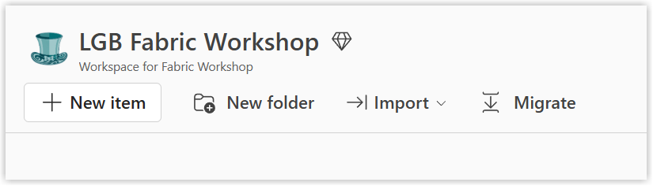

+++
title = "Lab 1: Workspaces"
weight = 10
+++

## Introduction

In this lab, you’ll create a Fabric workspace, the top-level container for everything you build. You’ll then check that the correct capacity is assigned to it and create a task flow to organise your work.

If a workspace has already been created for you because of restrictions in your tenant, open it and continue to [Workspace Settings](#workspace-settings).

## Creating a Workspace

The first task is to create a workspace. This is where all of your lab work will be completed.

> [!NOTE]Instructions
> 1. Navigate to [https://app.powerbi.com/](https://app.powerbi.com/).
> 1. On the side menu, click on **Workspaces** to open the workspaces pane.
> 1. At the bottom, click on **New workspace**.
> 1. In the panel that opens on the right, enter a unique name for the workspace. I recommend including your name or initials for these training workspaces.
> 1. **Description**, **Domain** and **Image** are optional but your admins might require them.
> 1. Under **Workspace type**, scroll down to find either **Fabric** or **Fabric Trial** and click the radio button.
> 1. Under **Details**, make sure the correct capacity is selected. Ask the trainer if you’re unsure which capacity to use.
> 1. Click **Apply** to create your workspace.

> [!NOTE]
> Some organisations do not allow workspaces to be created by users. This was mentioned in the prerequisites and you should have requested a workspace in advance.

## Workspace Settings

Once created, the workspace opens. In the top-left corner, you’ll see its name, image and description.

A diamond icon indicates that the workspace supports Fabric content. Additional icons indicate whether it uses a trial capacity or belongs to a domain.

Select **Workspace settings** to review or change these settings under **General** and **Workspace type**. To assign a different capacity, select **Edit**.

## Creating a Task Flow

Task flows help you organise the items in your workspace into logical steps, such as getting data, preparing it and building reports. In this lab, you’ll create a task flow to show how the different parts of your Fabric solution fit together.

> [!NOTE]Instructions
> 1. In the top half of the empty workspace click **Add a task**.
> 1. From the drop-down menu, select **Store data** and a task will appear.
> 1. Select **Add a task** again and select **Get data**.
> 1. Arrange the tasks with **Get data** on the left and **Store data** on the right.
> 1. Click and drag from the edge of **Get data** to **Store data** to create a connection.

### Editing Tasks

Task titles and descriptions can be edited to distinguish similar tasks and reflect your data process.

> [!NOTE]Instructions
> 1. Click on a task.
> 1. In the task pane, click on **Edit**.
> 1. Type in a new **Task name** and **Description**.
> 1. Click **Save** to see the changes on the task.

## Completing the Flow

In this workshop, you’ll load JSON data, transform it into tables and clean it for reporting. The task flow below represents this process.

> [!NOTE]Exercise
> Complete the task flow with five connected tasks in this order: **Get data**, **Store data**, **Develop Data**, a second **Store data** task renamed **Gold Layer**, and **Visualize**.

## Useful References

- [Microsoft Learn - Workspaces in Microsoft Fabric and Power BI](https://learn.microsoft.com/en-us/fabric/fundamentals/workspaces?wt.mc_id=DX-MVP-5003563)

- [Microsoft Learn - Task flows in Microsoft Fabric](https://learn.microsoft.com/en-us/fabric/fundamentals/task-flow-overview)

- [Microsoft Learn - Roles in workspaces in Microsoft Fabric](https://learn.microsoft.com/en-us/fabric/fundamentals/roles-workspaces)
