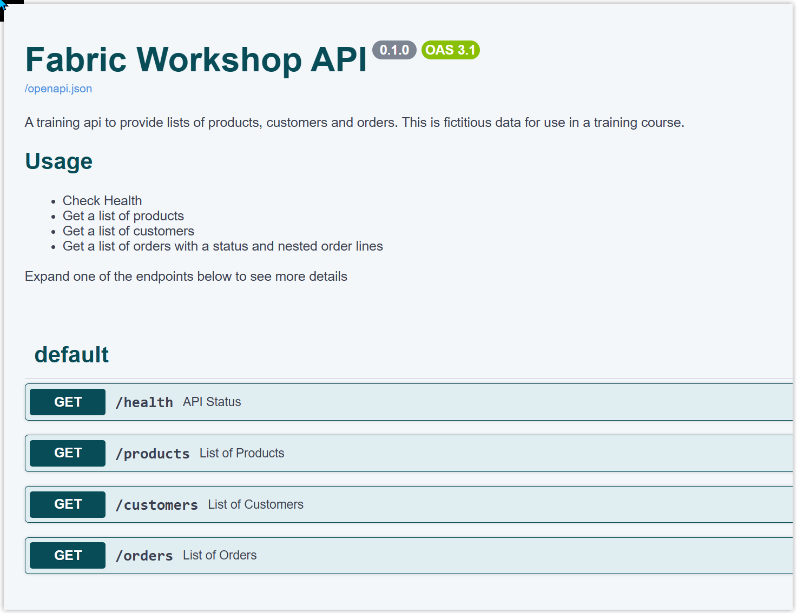

+++
title = "Lab 3: Ingesting API Data with a Pipeline"
weight = 30
+++

## Introduction

An **API** (application programming interface) lets one application request data or services from another. In this lab, you’ll use a simple public API that returns sample business data as JSON. You’ll create a Fabric pipeline to orchestrate copying the API responses into the **Files** area of your lakehouse.

The **Bronze layer** is the first stage of our workshop. Here, we’ll call the API and copy its JSON data into the lakehouse, keeping it close to its original form for later stages.

## Exploring the API

The interactive [API documentation](https://fabric-workshop-api.agreeablebeach-0b5e9550.uksouth.azurecontainerapps.io/docs) describes the available endpoints. This training API is public and does not require authentication. The API has endpoints for [products](https://fabric-workshop-api.agreeablebeach-0b5e9550.uksouth.azurecontainerapps.io/products), [customers](https://fabric-workshop-api.agreeablebeach-0b5e9550.uksouth.azurecontainerapps.io/customers), and [orders](https://fabric-workshop-api.agreeablebeach-0b5e9550.uksouth.azurecontainerapps.io/orders). 

### Base URL
```
https://fabric-workshop-api.agreeablebeach-0b5e9550.uksouth.azurecontainerapps.io/
```



We’ll start by bringing in the products response as `products.json`. Then you’ll repeat the same process for customers and orders. The orders response includes nested order-line data, which we’ll preserve in the JSON file.

## Create a Pipeline

A pipeline is a way to orchestrate data work: it holds activities and controls how they run. A **Copy data** activity moves data from a source to a destination. In this lab, the pipeline will contain copy activities that request each API endpoint and save its response in the lakehouse.

> [!NOTE]Instructions
> 1. Open the workspace and view task flow you created in the previous lab.
> 1. On the **Get data** task, select **New item**.
> 1. Select **Pipeline**.
> 1. Name the pipeline `Products_Pipeline` and, if prompted, associate it with the **Get data** task in your task flow.
> 1. Select **Create**.


## Add a Copy Data Activity

Add the first activity to copy the products response.

> [!NOTE]Instructions
> 1. In the pipeline editor, select **Copy data** from the activities ribbon, then choose **Add copy data activity**.
> 1. On the **General** tab, enter `Get Products JSON file` as the activity name.
> 1. A Description is recommended but is optional.


## Set the API Source

Configure the activity to call the API and get a JSON response.

> [!NOTE]Instructions
> 1. Open the **Source** tab. For **Connection**, choose **Browse all**, search for **HTTP**, and select it.
> 1. For the connection URL, use the base URL shown above. Keep the endpoint path out of this URL; you’ll enter it as the relative URL in the next step.
> 1. As this is the first time using this URL, create a new connection. Enter a recognizable name and select **Anonymous** for authentication, then select **Connect**. You can reuse this connection for the other API endpoints.
> 1. Set **Relative URL** to `products` and the source file format to **JSON**. 
> 1. Use **Preview data** to check that the source returns product data.


## Set the Lakehouse Destination

Configure the activity to save the response as a JSON file in your lakehouse.

> [!NOTE]Instructions
> 1. Open the **Destination** tab. For **Connection**, choose **Browse all**, then select your lakehouse from the OneLake catalog.
> 1. Set the **Root folder** to **Files** (not **Tables**).
> 1. Enter `products.json` as the file name. Leave the directory blank to save the file at the top level of **Files**.
> 1. Set the destination file format to **JSON**.
> 1. Under **Advanced**, set **Copy behavior** to **Preserve hierarchy** so the JSON response structure is retained.


## Run and Check the Results

The copy data activity is now complete. You can now run the pipeline to check that the API data is copied into the lakehouse.

> [!NOTE]Instructions
> 1. On the **Home** or **Run** ribbon, select **Run** and wait for the pipeline run to finish. If prompted, select **Save and run**.
> 1. Check the activity run status. A successful run is shown with a green check mark.
> 1. Return to the workspace and open your lakehouse.
> 1. Open **Files**. If `products.json` is not visible, open the **...** menu and select **Refresh**.
> 1. Select the file to inspect it. If the JSON is displayed on one line, use **Format content** to make it easier to read.


You should now see the product data from the API stored as a JSON file in your lakehouse.

## Exercise: Add Customers and Orders

Create a separate pipeline for each endpoint, naming them `Customers_Pipeline` and `Orders_Pipeline`. In each pipeline, add a **Copy data** activity, use the same HTTP source connection and lakehouse **Files** destination, and save each response as its own file:

| Activity name | Relative URL | Destination file |
|---|---|---|
| `Customer JSON file` | `customers` | `customers.json` |
| `Order JSON file` | `orders` | `orders.json` |

For each activity, set the source and destination formats to **JSON** and preserve the JSON hierarchy. The orders endpoint returns orders with nested order lines; keeping the response as JSON retains that nested structure. Save the pipeline and run it again, then refresh **Files** in the lakehouse and open `customers.json` and `orders.json` to inspect them.

## Lab 3 Complete

At the end of the lab you should have 3 data pipelines in the workspace and 3 JSON files in the lakehouse.


## Useful References

- [Microsoft Learn - Pipelines in Data Factory](https://learn.microsoft.com/en-us/fabric/data-factory/pipeline-overview?wt.mc_id=DX-MVP-5003563)
- [Microsoft Learn - How to copy data using copy activity](https://learn.microsoft.com/en-us/fabric/data-factory/copy-data-activity?wt.mc_id=DX-MVP-5003563)
- [Microsoft Learn - Configure HTTP in a copy activity](https://learn.microsoft.com/en-us/fabric/data-factory/connector-http-copy-activity?wt.mc_id=DX-MVP-5003563)
